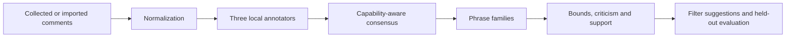

# Indonesian Comment Moderation

I built a Python proof of concept for discovering moderation-filter suggestions from Indonesian comments while accounting for legitimate criticism and ambiguity. I implemented collection interfaces, normalization, local annotator adapters, consensus, phrase-family mining and evaluation.

Developed by [Vavan Farizzaman](https://github.com/VavanZaa).

## Algorithm

1. Collect or import comments and retain original and normalized text as separate fields; pseudonymize author identifiers at ingest.
2. Run complementary local annotators: an IndoBERTweet harm classifier, deterministic lexicon/rule matching and a contextual Indonesian language model.
3. Map incompatible taxonomies through explicit adapters. Combine evidence according to each annotator's capabilities rather than applying a symmetric majority vote.
4. Group spelling variants into phrase families and count the deduplicated union of matching comments.
5. Calculate harmful-rate lower/upper bounds, collateral criticism and support. Apply the frozen family-level recommendation rule without smoothing away ambiguity.
6. Compare against raw-text and normalized static-list baselines; freeze the pipeline before evaluating the held-out figure across platforms.

## Workflow



## Run

Commands below assume a Windows terminal at the repository root unless stated otherwise.

```powershell
python -m venv .venv
.venv\Scripts\python -m pip install -r requirements.txt
# Offline software checks; no model download or live collection:
.venv\Scripts\python -m pytest -q
```

## Code map

`src/`: ingestion, annotators, consensus, mining, freeze and reporting; `prompts/`: local contextual-annotation prompt; `config/poc.yaml`: example configuration; `scripts/`: classifier training; `tests/`: synthetic/offline checks.

## Scope and evidence

The original automated annotation campaign found no qualifying phrase family under its stated configuration; this is not human-labelled ground truth or a validated production filter. The source snapshot includes later protocol corrections. Real comments, local configuration, usernames and model weights are excluded. Supply your own permitted inputs and local models for live runs; fixture/stub output demonstrates plumbing only.

This is a focused source snapshot. Installed dependencies, local environments and bulk generated research assets are rebuilt or supplied separately. See [VALIDATION.md](VALIDATION.md) for the checks performed on this export and any remaining setup requirements.
